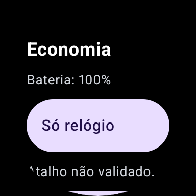

# Evidências de execução — Wear OS 5/API 34

AVD circular de 384×384 px/192 dp, sem firmware Samsung. Estas são capturas reais do emulador, sem edição, obtidas após sincronização do desenho. Não são mockups nem capturas do Watch8. Bateria de 100% é um valor do emulador, sem relação com autonomia.

## Revisão visual

| Fluxo | Fonte 1,0 | Fonte 1,3 | Observação |
|---|---|---|---|
| Painel | [Normal](home-font-1_0.png) | [Ampliada](home-font-1_3.png) | “Só relógio” visível sem rolagem. |
| Medição | [Normal](measurement-font-1_0.png) | [Ampliada](measurement-font-1_3.png) | Ação de início antes das instruções extensas. |
| Componente inválido | [Normal](destination-error-font-1_0.png) | [Ampliada](destination-error-font-1_3.png) | Mensagem reaparece após repetir o mesmo erro. |
| Rolagem rotativa | [Normal](rotary-scroll-font-1_0.png) | [Ampliada](rotary-scroll-font-1_3.png) | Lista responde ao evento Android; não comprova o bezel físico Samsung. |

Antes do ajuste, [esta captura de desenvolvimento](home-antes-ajuste.png) mostra o botão principal abaixo de três linhas de status, com rótulo cortado. Ela usa a disposição anterior; não representa o APK publicado v0.2.1.

Os itens que atravessam a borda circular continuam cortados durante a rolagem; podem ser trazidos ao centro. A revisão não cobre toda a experiência de teclado, TalkBack ou outras telas/resoluções.

## Saídas automatizadas

- [Seis testes aprovados, fonte 1,0](instrumentation-font-1_0.txt).
- [Seis testes aprovados, fonte 1,3](instrumentation-font-1_3.txt).
- [Resumo do AVD, hash do APK debug e contagens](summary.json).

Os testes executados são descritos no [guia reproduzível](../../emulator.md). As saídas foram revisadas antes da publicação; não incluem dumps ou identificadores de dispositivo pessoal.

## APK de release

Além da instrumentação debug, o APK assinado v0.2.0 foi instalado no mesmo AVD e atualizado para v0.2.1 com `adb install -r`, sem desinstalação entre as releases. A atualização e a abertura do painel funcionaram. O atalho abriu as configurações gerais do Wear OS como fallback; nenhuma confirmação Samsung foi comprovada.

O painel reabriu após parada forçada. Depois do reinício do AVD, painel e fallback abriram novamente. Não foi feito reinício do computador. Tile, complicação e duplo clique em Home não estão cobertos por essa verificação.

APK v0.2.1: `versionCode=3`, `versionName=0.2.1`, application ID preservado, 2.968.265 bytes, SHA-256 `55e615db70ced8236322db28b4f019d036730663408f280e8d3721b536ff6697`. A assinatura usa o mesmo certificado persistente das duas versões anteriores. O hash debug em `summary.json` é de outro artefato e não deve ser usado para conferir a release.
