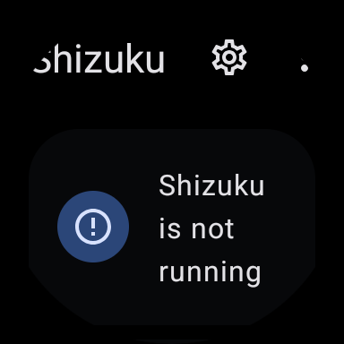
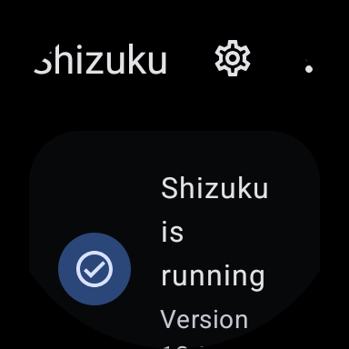

# Shizuku oficial em Wear OS 5 — 21/10/2026

Prova exploratória no AVD reservado `WatchReserve_Wear5_Small_Round`: API 34, tela circular
384 × 384, 320 dpi/192 dp, ABI x86_64. Nenhuma alteração no relógio físico. Não é medição
de autonomia nem comprovação da economia Samsung.

## Artefato

- Origem: [asset da release oficial 13.6.0](https://github.com/RikkaApps/Shizuku/releases/tag/v13.6.0).
- Arquivo: `shizuku-v13.6.0.r1086.2650830c-release.apk`, 2.571.773 bytes.
- SHA-256: `6e273ab0e991c4e79bc8b1bbb9b9dd739ccac1a8712a541a214078886b7b790f`.
- Assinatura verificada por `apksigner`; certificado SHA-256:
  `268b5590e868fb08bae7e0ac413564cd1ff88f5ccff74af9dbd0dc918e30db30`.
- Versão instalada: `13.6.0.r1086.2650830c`, código 1086, minSdk 24, targetSdk 36.
- O texto “Version 13.5, adb” da tela é a versão da API do servidor; não substitui a
  versão do APK registrada acima.

APK obtido diretamente da release por HTTPS. Verificação de assinatura confirma integridade
criptográfica; o certificado observado foi registrado, sem afirmar comparação com um pin
independente prévio. Não republicamos o binário upstream.

## Procedimento executado

1. Confirmar `ro.kernel.qemu=1`, nome do AVD e configuração `round`/`watch` antes de instalar.
   Registrar estado de Wi-Fi, modo avião, ADB e prazo de autorização fora do repositório.
2. Instalar o APK oficial, abrir `moe.shizuku.manager.MainActivity` e capturar o estado inicial.
3. Executar pelo ADB do AVD o `lib/x86_64/libshizuku.so` do diretório nativo instalado,
   conforme o comando de inicialização da versão. Não usar `adb root`.
4. Confirmar `shizuku_server` em `ps` como `shell`. Encerrar somente o gerenciador por
   `am force-stop`, reabri-lo e conferir status por UI Automator e captura.
5. Tentar `svc wifi disable`. O controlador Wear voltou a ligar o rádio; a leitura retornou
   `wifi_on=1` e serviço habilitado, logo a tentativa não foi aceita como teste offline.
   O dump Wear registrava decisão `ON_CHARGING:ON_USER_UNLOCKED`; não atribuir essa decisão
   ao Shizuku nem considerar o retorno do comando prova de desligamento.
6. Registrar modo avião anterior e ativá-lo no AVD por `cmd connectivity airplane-mode enable`.
   Confirmar `wifi_on=0` e `cmd wifi status` com `Wifi is disabled`. Encerrar/reabrir novamente
   o gerenciador; verificar texto de servidor ativo e processo shell ainda existente.
7. Encerrar o servidor iniciado para a prova e remover o APK oficial. Restaurar os valores
   registrados de `wifi_on`, `airplane_mode_on`, `adb_enabled`, `adb_wifi_enabled` e
   `adb_allowed_connection_time`, inclusive ausência de chave. Conferir estado, ausência do
   pacote/processo e encerrar o AVD.

O transporte ADB do emulador permaneceu disponível para observar o teste; não é ADB sem fio
do relógio físico. Wi-Fi desligado em modo avião não reproduz a política de economia Samsung.
Nenhum AppOp, pacote de terceiros, configuração de alarme ou controle de economia foi alterado.
O início oficial pode conceder `WRITE_SECURE_SETTINGS` ao próprio gerenciador; essa instalação
e sua permissão foram removidas ao concluir, sem concessão ao WatchReserve.

## Resultado e revisão de acabamento

| Verificação | Resultado |
|---|---|
| Instalar e abrir gerenciador oficial na imagem Wear | Aprovado |
| Iniciar servidor sem root, identidade shell | Aprovado |
| Gerenciador reaberto confirma Binder com Wi-Fi habilitado | Aprovado |
| Gerenciador reaberto confirma Binder com Wi-Fi desligado em modo avião | Aprovado |
| Restauração e remoção dos componentes de teste | Aprovado |
| Autorização e operações de um cliente WatchReserve | Não executado |
| Reinício do sistema, autoarranque e economia Samsung | Não executado |
| Alarme e ganho líquido de autonomia | Não executado |

As capturas mostram cortes no título superior, texto do status em múltiplas linhas e conteúdo
abaixo da área útil. É uma limitação real de acabamento do gerenciador de celular no relógio.
O teste não navegou por autorização/pareamento; sua usabilidade continua pendente.

| Antes de iniciar | Servidor ativo, Wi-Fi desligado em modo avião |
|---|---|
|  |  |

Capturas do emulador inspecionadas antes de publicar. XMLs brutos e logs ficam fora do Git.
Não há dados do relógio pessoal nessas imagens. Estudo e próximos critérios em
[Shizuku no Wear OS](../../referencias/shizuku-wearos.md).
